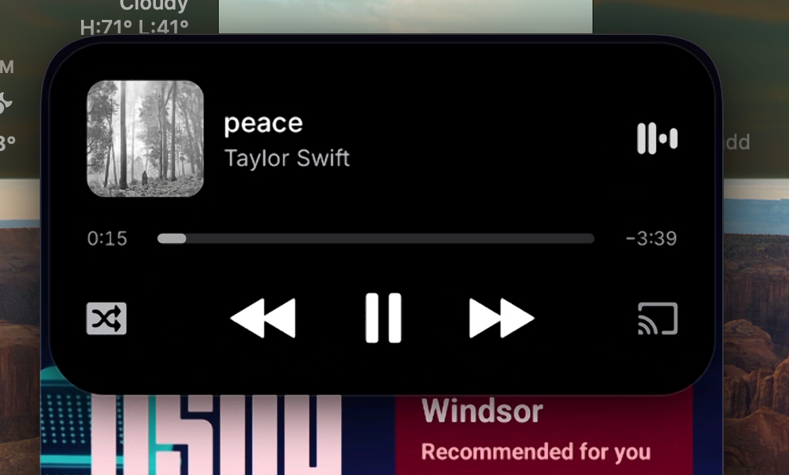
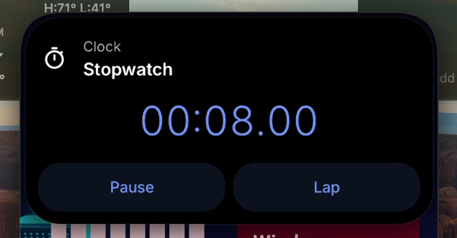
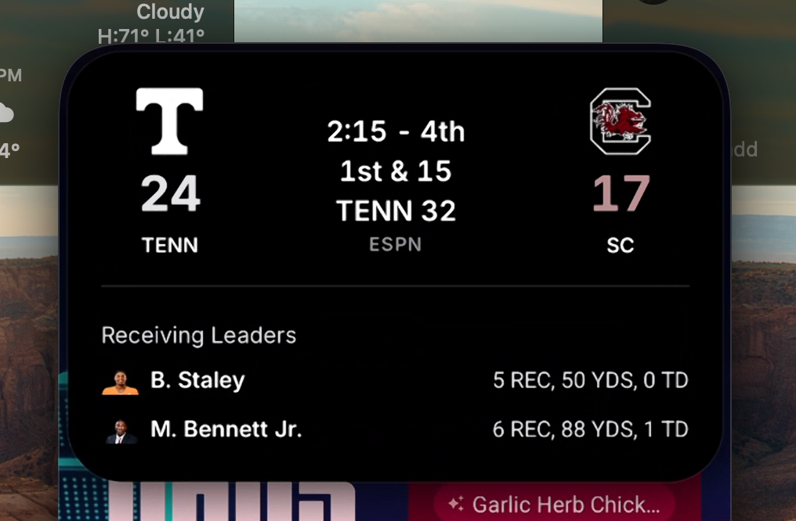
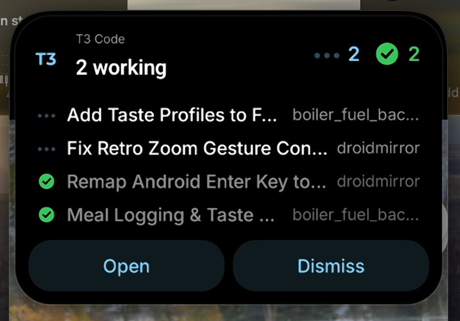

# Dynamic Island (WIP)

A Dynamic Island for Android, bringing music controls and ongoing activities
into a compact overlay around your camera cutout.
  
https://github.com/user-attachments/assets/f726ecc7-1f49-4c43-bee4-c8d1b511e7c3

(video uses fake data, screenshots below use real data)

## Features

- **Music controls** with album artwork, playback progress, and transport controls.
- **Live activities** for supported notifications, including sports scores, timers,
  stopwatches, calls, and transfers.
- **Agent activity** showing running and completed tasks from supported notifications.
- **Multiple activities** in compact bubbles, with expanded views for more detail.
- **Calibration** to adjust the island's placement for your display (usually not necessary, as this can detect camera cutouts).

Activity details and available actions depend on the source app's notifications.

## Preview

<table>
  <tr>
    <td width="50%"><br /><strong>Now playing</strong></td>
    <td width="50%"><br /><strong>Stopwatch</strong></td>
  </tr>
  <tr>
    <td><br /><strong>Sports scores</strong></td>
    <td><br /><strong>Agent activity</strong></td>
  </tr>
  <tr>
    <td><strong>Google Maps</strong></td>
    <td><strong>Many Other Live Activities</strong></td>
  </tr>
</table>

## Getting started

Requires Android 12 (API 31) or later.

<a href="https://apps.obtainium.imranr.dev/redirect?r=obtainium://add/https://github.com/Firebolt9907/dynamic-island">
  
</a>

1. Install the APK (from [Releases](https://github.com/Firebolt9907/dynamic-island/releases) or via Obtainium above) and open **Dynamic Island**.
2. Grant **Notification access** so the island can read media controls and ongoing activities.
3. Enable the app's **Accessibility service** to display and interact with the island.
4. Optionally grant **Nearby devices** access for headphone battery information.
5. Use the calibration controls to fit the island to your camera cutout.

## Build

Use JDK 21 and an Android SDK with platform 36 installed. Set your SDK path in
`local.properties` (`sdk.dir=/path/to/Android/sdk`) or configure `ANDROID_HOME`.
The repository includes the Gradle wrapper.

```sh
./gradlew :app:assembleDebug
```

The debug APK is written to `app/build/outputs/apk/debug/app-debug.apk`.

## Development

The app uses Kotlin, Jetpack Compose, and Android media sessions.

```sh
./gradlew :app:testDebugUnitTest
```

### Showcase demo (debug builds)

`scripts/showcase.sh` cycles the island through common activities (music, T3 Code agents,
an ESPN score change, Maps turns, a Blip transfer, a timer, a call, an Uber ride, and several
at once) for recording smoothness GIFs. It only needs ADB and an installed debug build with
the accessibility service and notification access enabled.

```sh
scripts/showcase.sh start                     # loop every scene; ~3.2 s per step
scripts/showcase.sh start --step 2500 --once  # faster, single pass
scripts/showcase.sh start --scenes sports,nav,transfer --no-music
scripts/showcase.sh stop
```

The activities are synthetic notifications that go through the production parser, so they
appear in the island but not in the notification shade. Any real ongoing notifications on
the phone still appear alongside them.
